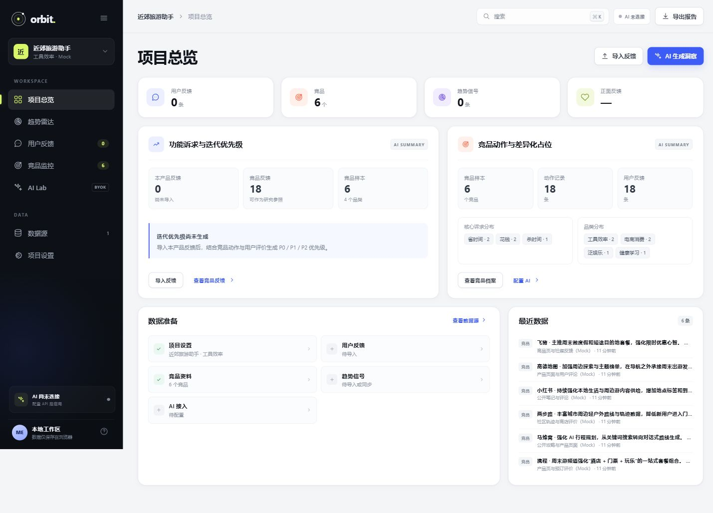
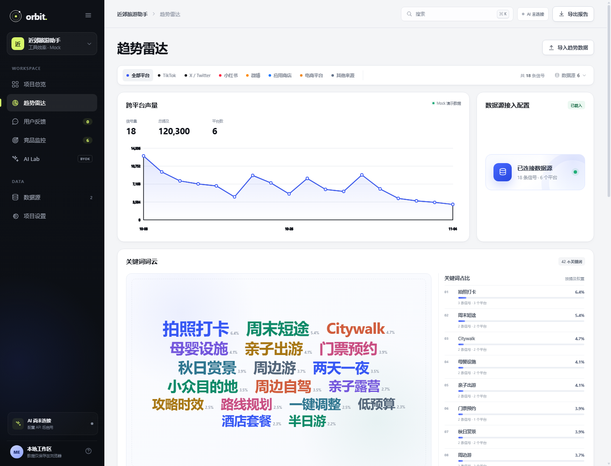
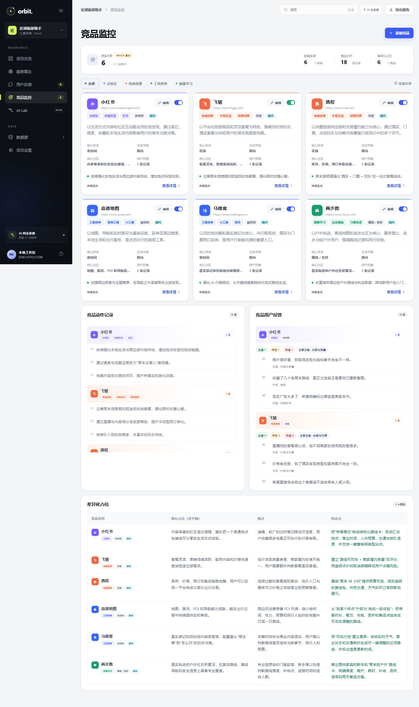

# Orbit · 产品调研工作台

Orbit 是一个本地优先、多项目的产品调研 Web 应用，用于整合用户反馈、趋势数据、竞品情报与 AI 分析。

项目提供完整的“数据导入 → 清洗 → 汇总 → 竞品对比 → AI 分析 → 报告导出”工作流，支持泛娱乐、电商消费、工具效率、健康学习等不同类型产品的调研场景。



## 功能模块

### 多项目工作区

- 创建、保存、切换和删除多个调研项目
- 每个项目拥有独立的反馈、竞品、趋势、AI 记录和接口配置
- 支持工作区 JSON 导入与导出
- 业务数据默认保存在浏览器 `localStorage`

### 项目总览

- 展示反馈量、竞品数、趋势信号数和正面反馈占比
- 汇总「功能诉求与迭代优先级」
- 汇总「竞品动作与差异化占位」
- 支持导出 Markdown 调研报告

### 趋势雷达

- 导入趋势 CSV / JSON
- 按平台筛选趋势信号
- 展示跨平台声量、信号量、总提及和平台数
- 关键词词云按提及权重调整字号
- 展示关键词占比 Top 8
- 平台筛选联动图表、词云、排行和信号列表



### 用户反馈

- 导入问卷或用户反馈 CSV
- 自动完成字段识别、数据清洗、情感判断和主题分类
- 展示反馈总览、情感分布、主题分布和数据来源
- 按问卷问题聚合反馈
- 保留每次文件导入记录，并支持撤销单次导入
- 支持 App Store 公开评价同步
- 支持华为、小米、vivo、OPPO 企业评价接口适配

### 竞品监控

- 按「泛娱乐 / 电商消费 / 工具效率 / 健康学习」划分竞品
- 支持细分赛道、核心诉求和主攻市场标签
- 记录竞品动作、核心占位、痛点、机会点和用户反馈
- 支持卡片内编辑和分类筛选
- 以四列表格展示差异化占位：竞品名称、核心占位、痛点、机会点



### AI Lab

- 支持自行接入 OpenAI-compatible API
- 支持 AI 文案 A/B 对比
- 支持上传 TXT、MD、CSV、JSON、LOG 文件进行分析
- 保存 AI 运行记录并支持回看
- API Key 仅保存在当前浏览器会话
- 无 API Key 时不生成模板式替代结果

## 技术栈

- HTML5
- CSS3
- 原生 JavaScript
- Node.js 18+
- Vercel Serverless Functions
- Browser `localStorage` / `sessionStorage`
- 无第三方前端依赖

## 快速开始

### 环境要求

- Node.js 18 或更高版本

### 启动本地服务

```bash
node server.mjs
```

或使用 npm：

```bash
npm start
```

启动后访问：

```text
http://localhost:4173
```

## 数据格式

### 用户反馈 CSV

```csv
feedback,question,source,rating,date,segment
"希望增加雨天备选路线","你希望获得怎样的周末出游推荐？","问卷星",5,2026-11-01,"亲子家庭"
```

支持的字段：

| 字段 | 说明 | 必填 |
| --- | --- | --- |
| `feedback` | 用户反馈正文 | 是 |
| `question` | 问卷问题 | 否 |
| `source` | 数据来源 | 否 |
| `rating` | 1–5 分评分 | 否 |
| `date` | 反馈日期 | 否 |
| `segment` | 用户类型或分组 | 否 |

### 趋势数据 CSV / JSON

常用字段：

```text
title, description, platform, mentions, delta, sentiment,
category, date, url, source, keywords
```

`keywords` 支持数组或逗号、分号、竖线分隔的字符串。JSON 中可以为关键词单独设置权重：

```json
{
  "title": "周末短途游热度上升",
  "platform": "xiaohongshu",
  "mentions": 12800,
  "date": "2026-11-01",
  "keywords": [
    { "name": "周末短途", "weight": 3200 },
    { "name": "亲子出游", "weight": 2100 }
  ]
}
```

### 竞品数据

竞品通过界面添加，标准化字段包括：

```json
{
  "name": "产品名称",
  "category": "电商消费",
  "tracks": ["美妆穿搭"],
  "need": "花钱",
  "market": "国内",
  "killer": "核心占位",
  "painPoint": "用户痛点",
  "opportunity": "机会点",
  "signal": "竞品动作",
  "userFeedback": ["用户反馈 1", "用户反馈 2"],
  "source": "官网 / 商店 / 访谈"
}
```

## AI API 接入

在 AI Lab 中填写：

- HTTPS Base URL
- 模型名称
- API Key

接口需要兼容 OpenAI `/chat/completions`。前端统一请求服务端 `/api/ai`，由服务端转发第三方请求。

AI 文件分析支持：

```text
.txt .md .csv .json .log
```

单文件大小限制为 1 MB。

## 应用商店评价接口

### App Store

使用 Apple 公开 RSS 评价接口，输入 App ID 与地区即可同步，无需 API Key。

### 国内应用商店

华为、小米、vivo、OPPO 通常需要企业开放平台授权。界面支持填写：

- App ID / 应用包名
- 企业评价 API Endpoint
- Access Token

服务端负责：

- HTTPS 校验
- 域名白名单校验
- 禁止重定向到白名单外地址
- 字段清洗与统一结构输出

如需追加企业网关，可以配置环境变量：

```text
REVIEW_ENDPOINT_ALLOWLIST=your-gateway.example.com,another-gateway.example.com
```

统一评价输出结构：

```json
{
  "reviews": [
    {
      "text": "评价内容",
      "source": "评价来源",
      "rating": 5,
      "date": "2026-11-01",
      "author": "用户昵称",
      "url": "评价链接"
    }
  ]
}
```

## 数据与安全

- 用户调研数据默认仅保存在当前浏览器
- AI Key 与评价 Access Token 不写入服务端存储
- 工作区备份会移除 API Key、Token 和 Authorization 等敏感字段
- AI 与评价接口代理拒绝非 HTTPS 地址
- 企业评价接口启用域名白名单和重定向保护
- 第三方接口无权限、不可达或返回字段不完整时，界面显示错误或空状态

## 演示数据

项目包含一个「近郊旅游助手」演示工作区，用于展示竞品、趋势和关键词词云等模块。

- 竞品、竞品动作、竞品反馈和趋势信号均为 Mock 数据
- 所有 Mock 来源均明确标注
- 新建项目默认空白
- 演示数据不会进入其他项目
- 用户删除演示项目后不会自动恢复

## 部署

### Vercel

项目可以直接部署到 Vercel，静态页面与 `/api/ai`、`/api/reviews` Serverless Functions 会一起发布。

```bash
npx vercel --prod
```

Vercel 项目设置：

| 配置 | 值 |
| --- | --- |
| Framework Preset | Other |
| Build Command | 留空 |
| Output Directory | 留空或 `.` |
| Root Directory | `./` |

部署时不需要配置 AI Key。`REVIEW_ENDPOINT_ALLOWLIST` 为可选环境变量。

## 项目结构

```text
.
├── index.html                 # 页面结构
├── assets/
│   ├── app.js                 # 交互、数据清洗、项目状态与 AI 调用
│   ├── styles.css             # 页面样式与响应式布局
│   ├── data.js                # 分类、平台和评价源预设
│   └── demo-data.js           # Mock 演示项目数据
├── api/
│   ├── ai.mjs                 # OpenAI-compatible API 代理
│   └── reviews.mjs            # 应用商店评价接口适配器
├── docs/
│   ├── PRD.md                 # 产品需求文档
│   └── DEPLOYMENT.md          # 部署说明
├── server.mjs                 # 本地静态服务器与 API 代理
├── vercel.json                # Vercel 配置
└── package.json
```

## 已知限制

- 趋势数据通过 CSV / JSON 导入，不包含绕过平台限制的实时抓取
- TikTok、X 等平台的企业级实时接口需要相应授权，项目预留标准化数据层以便替换
- 国内应用商店评价接口需要企业开放平台权限
- AI 分析结果取决于用户配置的第三方模型
- 当前不提供账号系统、云端同步或多人协作
- 浏览器数据会受当前浏览器和存储空间限制

## 文档

- [产品需求文档](docs/PRD.md)
- [部署说明](docs/DEPLOYMENT.md)
